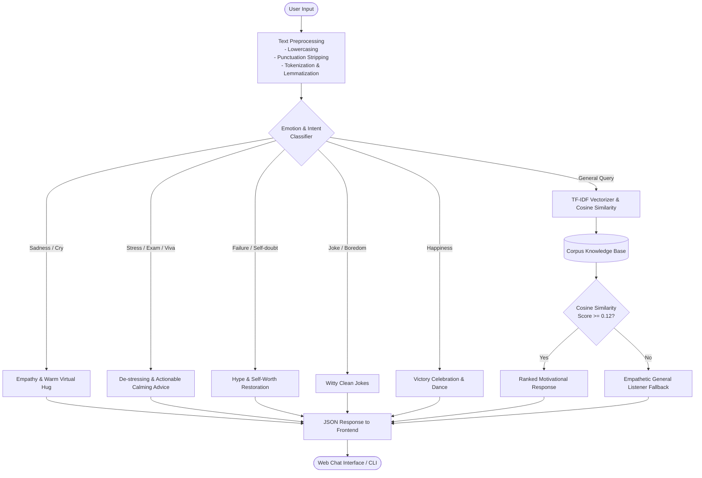

# BuddyBot: Emotion-Aware Conversational AI Companion
## Final Year Project Documentation & Report Summary

---

### 1. Project Title
**BuddyBot: An Intelligent Conversational AI Companion for Emotional Support, Motivation, and Stress Relief**

- **Domain**: Artificial Intelligence (AI), Natural Language Processing (NLP), Web Development
- **Technology Stack**: Python, Flask, NLTK, Scikit-Learn, HTML5/CSS3/JavaScript

---

### 2. Abstract / Executive Summary
In today's fast-paced digital world, students and professionals frequently face mental exhaustion, anxiety, burnout, and loneliness. Traditional informational chatbots answer domain-specific transactional queries but lack empathy, humor, and emotional awareness.

**BuddyBot** is a conversational AI system designed to act as an accessible, 24/7 emotional companion. It combines rule-based intent recognition, emotion lexicon matching, and statistical Natural Language Processing (TF-IDF vectorization with Cosine Similarity). The bot detects feelings such as sadness, exam stress, fatigue, loneliness, and self-doubt. In response, it provides comforting words, motivational pep talks, gentle humor, and mindfulness reminders. With an intuitive web interface, BuddyBot offers a safe, judgment-free space for everyday conversational comfort.

---

### 3. Problem Statement & Motivation
- **High Stress & Burnout**: Academic pressure, viva examinations, coding bugs, and deadlines often leave students overwhelmed.
- **Reluctance to Seek Help**: Many hesitate to express vulnerable feelings to peers due to fear of judgment.
- **Limitation of Existing Bots**: Most chatbots are rigid and informational (e.g., booking tickets or answering product FAQs). There is a significant gap for lightweight, privacy-focused conversational bots tailored for mental wellness and everyday motivation.

---

### 4. Project Objectives
1. Build a responsive, empathetic conversational chatbot in Python.
2. Implement an NLP pipeline consisting of text cleaning, tokenization, and WordNet lemmatization.
3. Detect key emotional categories (Sadness, Stress, Exhaustion, Low Self-esteem, Loneliness, Happiness, Humor request).
4. Utilize **TF-IDF (Term Frequency - Inverse Document Frequency)** and **Cosine Similarity** to match nuanced inputs with a curated motivational and comforting knowledge base.
5. Create a modern, responsive web application using Flask and RESTful API endpoints (`/api/chat`).
6. Provide a user-friendly UI with suggestion chips, typing indicators, and message history.

---

### 5. System Architecture & Workflow

---

### 6. Technical Stack & Modules

| Component | Technology | Purpose |
| :--- | :--- | :--- |
| **Programming Language** | Python 3.13 | Core backend and machine learning logic |
| **NLP Library** | NLTK (Natural Language Toolkit) | Word tokenization, sentence splitting, WordNet lemmatization |
| **Machine Learning** | Scikit-Learn (sklearn) | `TfidfVectorizer` and `cosine_similarity` computations |
| **Web Framework** | Flask | Lightweight microframework serving templates and API routes |
| **Frontend** | HTML5, CSS3, JavaScript (Fetch API) | Modern, responsive dark-theme chat interface |
| **Data Format** | JSON | Communication between frontend client and Flask server |

---

### 7. Core Algorithms & Mathematical Concepts

#### A. Lemmatization & Tokenization
Text is normalized into standard base words (lemmas) using WordNet so that grammatical variations (`crying`, `cried`, `cries`) map to the common root `cry`.

#### B. TF-IDF (Term Frequency - Inverse Document Frequency)
TF-IDF reflects the relative importance of words within the document corpus:
$$\text{TF}(t, d) = \frac{\text{Count of term } t \text{ in document } d}{\text{Total terms in document } d}$$

$$\text{IDF}(t, D) = \log\left(\frac{1 + N}{1 + \text{DF}(t)}\right) + 1$$

$$\text{TF-IDF}(t, d, D) = \text{TF}(t, d) \times \text{IDF}(t, D)$$

#### C. Cosine Similarity
Measures the directional alignment (angle) between the user query vector $\mathbf{u}$ and candidate knowledge base vectors $\mathbf{v}$:
$$\text{Cosine Similarity}(\mathbf{u}, \mathbf{v}) = \frac{\mathbf{u} \cdot \mathbf{v}}{\|\mathbf{u}\| \|\mathbf{v}\|} = \frac{\sum_{i=1}^{n} u_i v_i}{\sqrt{\sum_{i=1}^{n} u_i^2} \sqrt{\sum_{i=1}^{n} v_i^2}}$$

A similarity threshold ($\tau = 0.12$) is applied to filter low-confidence semantic matches.

---

### 8. Key Features of the Chatbot

1. **Multi-Category Emotion Support**: Accurately differentiates between academic stress, personal sadness, exhaustion, and need for humor.
2. **Humor & Jokes Generator**: Relieves tension with lighthearted programming and everyday jokes.
3. **Motivational & Hype Speeches**: Instills self-confidence and combats impostor syndrome.
4. **Clean Web Interface**:
   - Modern dark gradient palette (`#0f172a` / `#1e293b`).
   - One-click prompt suggestion chips.
   - Animated typing indicator (`...`).
   - Mobile and desktop responsive design.
5. **Dual Mode Operation**: Can be launched either as a local Web App (`python app.py`) or Terminal CLI (`python cli.py`).

---

### 9. Sample Test Cases & Results

| User Input Scenario | Detected Intent | Sample Chatbot Output |
| :--- | :--- | :--- |
| *"I had a terrible day and feel like crying"* | Sadness / Empathy | *"Sending you tons of comfort and warmth. 💕 Bad days are just chapters, not the whole book. Want to vent to me, or would you like a silly joke to make you crack a smile?"* |
| *"I am stressed about my exam and project"* | Academic Stress | *"Stressed spelled backwards is DESSERTS! 🍰 Coincidence? I think not! Go grab a bite, stretch your legs, and remember: you have survived 100% of the exams and chaos so far!"* |
| *"Tell me a joke"* | Humor | *"Why do programmers prefer dark mode? Because light attracts bugs! 🐛"* |
| *"I feel like a failure"* | Low Self-Esteem | *"Stop right there! 🛑 Who gave you permission to talk about my awesome friend like that?! You are NOT a failure. You're learning and fighting battles nobody knows about. Cut yourself some slack, legend! 👑"* |
| *"Hype me up!"* | Motivation | *"HYPE MODE ACTIVATED! 🔥 You are a powerhouse, a certified rockstar, and an unstoppable force! Whatever is standing in your way today doesn't stand a chance. Go conquer it! 🚀"* |

---

### 10. Advantages of the Project
- **Instant & 24/7 Availability**: Always ready to listen without delay.
- **Privacy & Safety**: Runs completely locally on the user's machine; no private user feelings are shared with third-party tracking APIs.
- **Low Latency & Lightweight**: Executes quickly without demanding expensive GPU resources.
- **Modular & Extensible**: New emotions, quotes, or knowledge corpora can be added by simply editing `corpus.txt` or updating dictionary responses.

---

### 11. Future Scope & Enhancements
1. **Speech Integration (STT & TTS)**: Allow users to speak naturally and hear spoken replies using Web Speech API or Whisper.
2. **Transformer Integration**: Incorporate small fine-tuned models (e.g., DistilBERT or RoBERTa) for deep sentiment analysis.
3. **Daily Mood Tracker**: Include a journal dashboard to visualize emotional patterns over time.
4. **Mobile Application**: Wrap the Flask backend into an Android/iOS React Native or Flutter app.

---

### 12. Conclusion
BuddyBot successfully demonstrates how Natural Language Processing and Machine Learning can be applied outside of standard data retrieval to foster empathy, mental well-being, and motivation. By coupling rule-based emotion recognition with TF-IDF cosine similarity and a clean web application, BuddyBot serves as an exemplary Final Year Computer Science Project.
